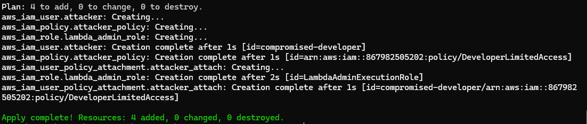
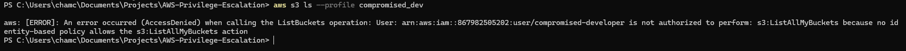
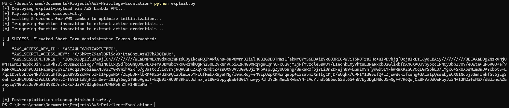
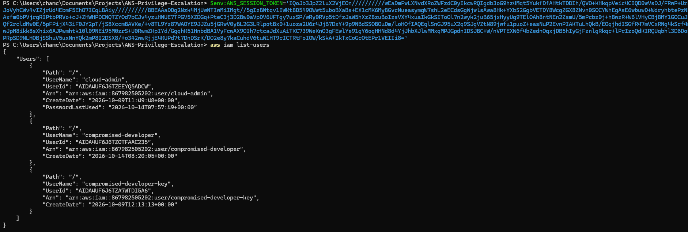
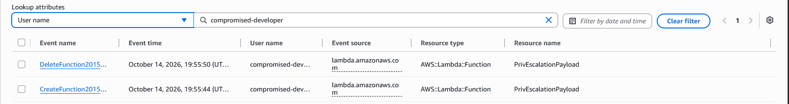

# AWS Cloud Security Lab: Serverless Privilege Escalation via IAM PassRole Misconfiguration

An advanced cloud security project demonstrating how an attacker can leverage an overly broad `iam:PassRole` configuration to elevate privileges from a heavily restricted identity to a full **AWS Administrator** using AWS Lambda. 

This repository implements a hands-on **"Break & Remediate"** model using Infrastructure as Code (IaC) via Terraform, offensive Python API automation, and defensive detection auditing via AWS CloudTrail.

---

## 🛠️ Project Architecture & Attack Flow

1. **Initial Access:** An attacker compromises a developer profile identity (`compromised-developer`). This user has zero access to high-value infrastructure or identity registers (such as listing S3 assets or modifying IAM configurations).
2. **The Flaw:** The developer user is accidentally granted a wildcard (`*`) privilege on the `iam:PassRole` action. This allows them to assign high-privilege roles to native computing resources.
3. **The Pivot:** The attacker executes a script that bundles a short-lived credential harvesting script, deploys it as a serverless AWS Lambda function, and attaches the pre-existing high-privilege `LambdaAdminExecutionRole` directly to it.
4. **Escalation:** The function executes within the context of full `AdministratorAccess`, capturing short-term AWS session variables (`STS Token Streams`) from the active execution environment and exfiltrating them straight back to the attacker's shell.

```
 [Low-Priv Attacker User] ──(Creates Lambda Payload + Passes Admin Role)──> [AWS Lambda Compute]
                                                                                │
                                                        (Executes & Extracts STS Admin Tokens)
                                                                                ▼
 [Stolen Admin Control Plane] <──(Exfiltrated Access Keys)──────────────────────┘
```

---

## 🏃‍♂️ Step-by-Step Lab Walkthrough & Forensic Evidence

### Step 1: Automated Infrastructure Deployment
The deployment phase initializes and spins up the baseline playground entirely via Terraform. This establishes a clean, repeatable environment for verification testing.

```bash
terraform init
terraform apply -auto-approve
```

#### 📸 Evidence 01: Infrastructure State Verified
Confirming the programmatic configuration of the target execution roles, attacker identity baselines, and restriction maps.


---

### Step 2: Verification of Initial Low-Privilege Status
To simulate the compromised user context, keys are generated for the `compromised-developer` and loaded into an isolated local terminal profile:

```powershell
aws configure --profile compromised_dev
aws s3 ls --profile compromised_dev
```

#### 📸 Evidence 02: Initial Authorization Block
The cloud baseline successfully blocks top-level actions, returning an explicit `AccessDenied` exception. This proves that the account did not start with standard administrative permissions.


---

### Step 3: Executing the Exploit Code
The `exploit.py` pipeline programmatically builds a runtime-compatible ZIP deployment archive, provisions a new serverless function using the compromised token set, and binds the high-privilege `LambdaAdminExecutionRole` using the identity flaw. It pauses briefly to bypass cold-start pending phases, executes, and parses the environment metrics.

```powershell
python exploit.py
```

#### 📸 Evidence 03: Exploit Execution & Token Harvesting
The serverless application runs successfully, exposing the active administrative temporary security tokens to the terminal output before running its self-destruct function.


---

### Step 4: Verification of Administrative Dominance
Using the harvested short-term values, environmental overrides are set in the terminal session, enabling the attacker profile to query root identity endpoints:

```powershell
$env:AWS_ACCESS_KEY_ID='ASIA4UF6J6TZA...'
$env:AWS_SECRET_ACCESS_KEY='X/6bPctZ9ao...'
$env:AWS_SESSION_TOKEN='IQoJb3JpZ2lu...'

aws sts get-caller-identity
aws iam list-users
```

#### 📸 Evidence 04: Full Crown-Jewel Access Confirmed
The `get-caller-identity` verification maps the active shell directly to the assumed serverless execution role, granting full account enumeration across all profiles (`cloud-admin`, `compromised-developer`, etc.).


---

### Step 5: Incident Investigation via AWS CloudTrail
From a defensive posture, this rapid sequence leaves a signature chronological footprint. Auditing the event history trace uncovers an identical timeline indicating compromise:

1. Navigate to the **AWS CloudTrail Console** -> **Event history**.
2. Filter the events registry using **User name** = `compromised-developer`.

#### 📸 Evidence 05: CloudTrail Behavioral Audit Trail
The audit logs reveal a tight, malicious operational chain: `CreateFunction` followed instantly by an unauthorized execution `Invoke` action, and immediate `DeleteFunction` evasion cleanup.


---

## 🛡️ Mitigation, Prevention, and Remediation

### 1. Hardening the IAM Privilege Map
The critical flaw in this configuration is allocating a wildcard (`*`) identifier to the `iam:PassRole` resource attribute. This allows the low-privilege entity to assign any identity in the entire cloud space—including the full administrator role—to a compute resource.

To correct this, update the policy code to strictly constrain the resource parameters using specific Amazon Resource Names (ARNs):

```json
{
    "Sid": "ScopedPassRolePrivileges",
    "Effect": "Allow",
    "Action": "iam:PassRole",
    "Resource": "arn:aws:iam::867982505202:role/StandardDevExecutionRole"
}
```

### 2. Implement IAM Permissions Boundaries
Applying a **Permissions Boundary** to the `compromised-developer` user ensures that even if they manage to create a serverless resource or assign an alternate identity, the maximum authority of that resource cannot bypass the limits defined in the boundary policy. This effectively keeps the developer locked into their intended authorization space.

---

## 🧼 Teardown and Cleanup
To safely clean up the playground and remove all vulnerable configurations from your AWS account, clear your terminal environment variables and execute the destroy phase:

```powershell
Remove-Item Env:\AWS_ACCESS_KEY_ID, Env:\AWS_SECRET_ACCESS_KEY, Env:\AWS_SESSION_TOKEN
terraform destroy -auto-approve
```
